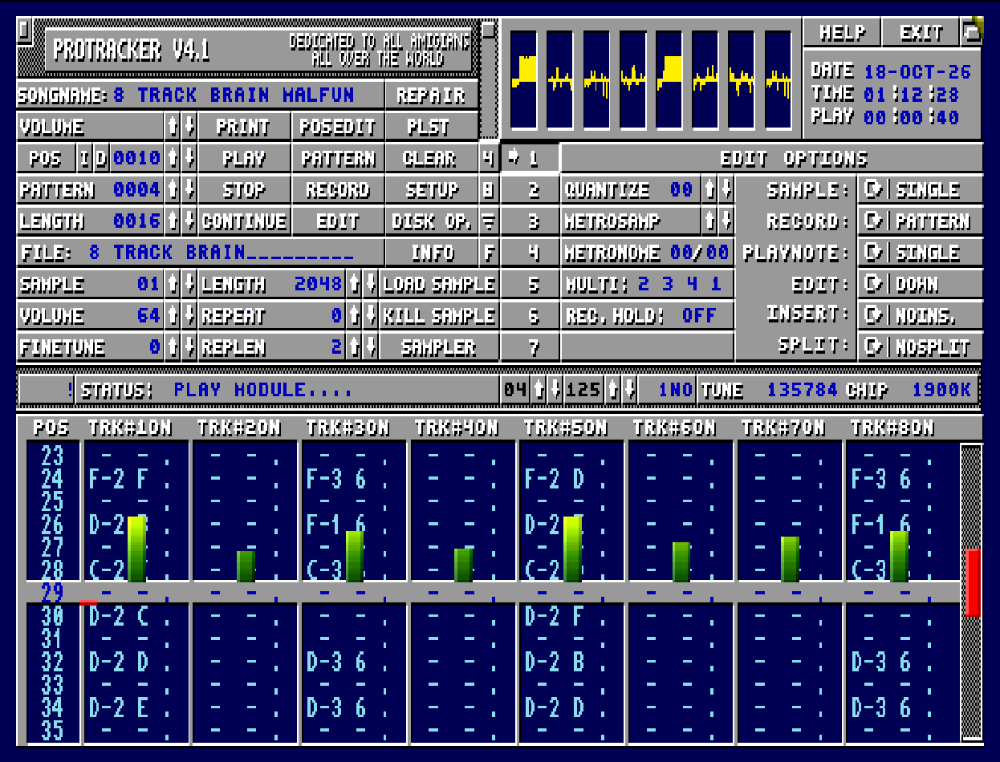
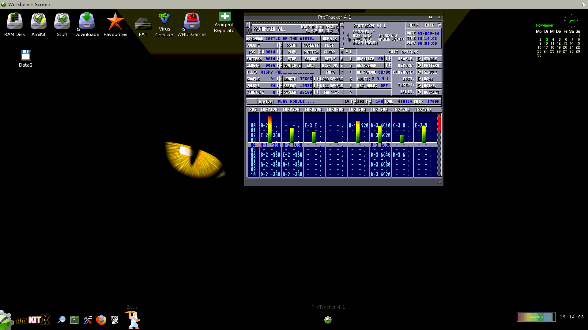
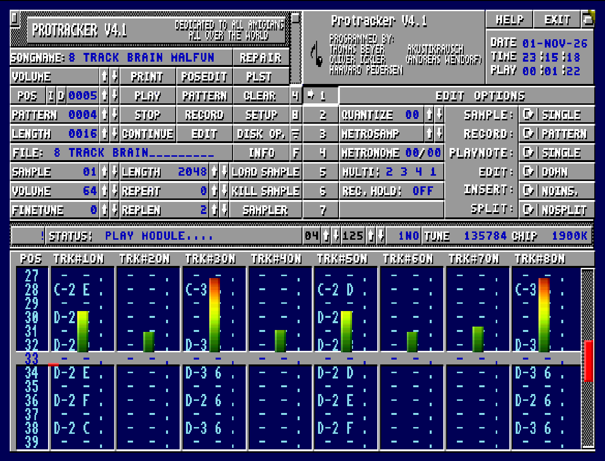
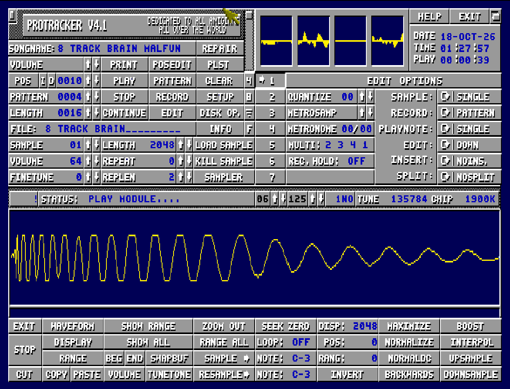
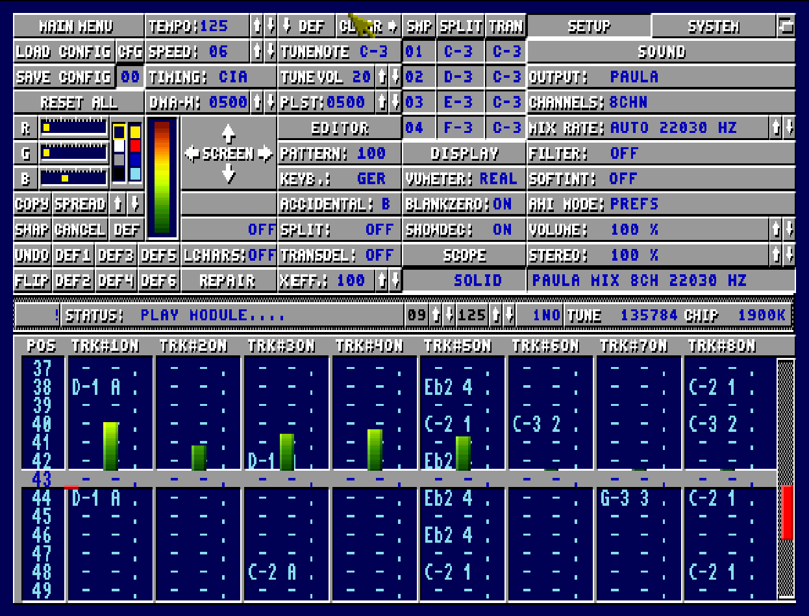

# ProTracker 4.1.1

Amiga music tracker. 68000 to 68060, Kickstart 2.04 or newer, 1 MB.
By Tom Beyer, Oliver Ickler, Haavard Pedersen and Akustikrausch (Andreas Wendorf), 2026.

ProTracker 4.1.1. Eight channels, graphics cards, sound cards, and the editor
you know.

## what it does

- Pattern editor for 4 or 8 tracks, 64 rows, up to 100 patterns, song
  position list, PLST, edit options: quantize, metronome, multi keyboard,
  record hold, sample / record / playnote / edit / insert / split modes.
- Edit op. pages with tools for tracks, patterns and samples, filter editor
  with modulation curve, chords, MIX IT (tracks rendered to a sample).
- Sample editor: maximize, normalize, normal dc, boost, interpol, upsample,
  downsample, resample, backwards, invert, tunetone, zoom, ranges, cut / copy
  / paste. Sampler with monitor. Volume envelopes (DYN, UNDYN).
- Disk op with long names, module / song / sample / track / pattern saving,
  SAVE EXE writes a module as a standalone player.
- Scopes, analyzer and VU meters, palette editor, 6 colour presets, online
  help, config slots.

## new in 4.1

- **8 channels.** 8CHN, OCTA, CD81 and FLT8 load, play and save. 68020 and up
  mix all eight at 22-28 kHz, a fast 68000 plays 1+2 on paula and mixes the
  rest, a 7 MHz A500 with fast ram mixes at 5 kHz. 8 channel mode is the
  default wherever the machine can take it.
- **VU meters and analyzer for all eight tracks**, side by side.
- **Runs on a plain 68000** (A500+, 1 MB) and up to the 68060.
- **Graphics cards (RTG).** Own card screen, or a resizable window on a
  graphics card workbench (full hd and up).
- **Sound cards (AHI).** 16 bit stereo through any AHI driver, picked
  automatically when AHI is installed, switchable while a song plays.
- **First start sets itself up:** cpu, sound and graphics are detected.
- WAV and AIFF samples (8/16 bit, mono/stereo), XPK packed files,
  partitions in the terabyte range.
- New effects 81y-87y: play backwards, blend track pairs and more.
- SAVE EXE and MIX IT in 8 channel mode, MIX IT without extra library.
- Setup in two pages (SETUP / SYSTEM), colour scheme 4.1 or the classic 2.3
  look, tempo changes timed like ProTracker 2.3D.
- Getting started page in the help, AmigaGuide manual.
- A long list of fixes against 4.0: scope hang, requester lockups,
  big directories, truncated modules and more.

## cpu

| machine | 4.1 does |
|---|---|
| 68000, 7 MHz, 1 MB chip (A500+) | full editor, 4 channels; 8 channels with fast ram at 5 kHz |
| fast 68000 (accelerator) | 8 channels |
| 68020 (A1200) | 8 channels at 22 kHz, AHI, RTG |
| 68030 / 68040 / 68060 | 8 channels at 28 kHz, AHI, RTG |

Kickstart 2.04 or newer, up to AmigaOS 3.2.x.

Tested setups: A500+ with 68000 and 1 MB chip on Kickstart 2.04,
A500 with fast ram, A500 with fast 68000, A1200 on Kickstart 3.1, A1200 on
AmigaOS 3.2.3 with AHI, A4000 with 68040 and 68060, A1200 with Picasso96,
AmiKit 12.1 (AmigaOS 3.2.2) with a full hd card workbench and AHI 6.7, and a
real A1200 with PiStorm32 lite (Emu68) and AmiKit on a full hd workbench.

## get it

`dist/ProTracker-4.1.lha` - unpack, drag the drawer anywhere, run. No installer.

## build it

    vasmm68k_mot -no-opt -Fhunkexe -nosym -kick1hunks -o ProTracker41 Protracker.asm

or `make VASM=/path/to/vasmm68k_mot`. vasm (m68k, mot syntax) by Volker
Barthelmann and Frank Wille: http://sun.hasenbraten.de/vasm/

## source

    Protracker.asm      equs, macros, include order
    src/sys/            startup, libs, interrupts, input, cpu, rtg, ahi
    src/engine/         replayer, song control, mixers, effects
    src/io/             disk op, load/save, iff/imp!, formats
    src/ui/             screens, gadgets, editors, sampler, setup, vu
    src/data/           data, chip data, bss, bin/ (graphics, exe player)
    include/            structs

## screens

## credits

ProTracker 4.1 by Tom Beyer, Oliver Ickler, Haavard Pedersen and Akustikrausch
(Andreas Wendorf). Based on 3.15 by CryptoBurners and ProTracker by Lars Hamre
and Amiga Freelancers. Earlier versions belong to their authors.

## licence

ProTracker (C) 1990 Lars Hamre, 1992-93 CryptoBurners, 1994-98 Tom Beyer,
Oliver Ickler. 4.1 additions (C) 2026 Akustikrausch (Andreas Wendorf). The
original parts stay with their authors; no claim is made on them.

Tom Beyer opened the ProTracker 4 source on Aminet
(mus/edit/PT4_Beta2_src.lha) under this condition: "Using this source code
is allowed as long as the names of *all* developers are visible in the
about requester of the executable." 4.1 keeps it: whoever builds on this
keeps all names in the about box. ProTracker 3.15 was released by
CryptoBurners as public domain.

Free, non-commercial hobby project. Not for sale. No warranty. See LICENSE.

dedicated to all amigans all over the world.
